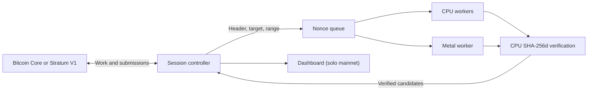

# Bitcoin Silicon Documentation

[README](README.md) · [Architecture](#architecture) · [Installation](#installation) · [Local services](#services-and-local-data) · [Wallet recovery](#wallet-and-recovery) · [Benchmarks](#mining-benchmarks) · [Tests](#tests)

## Architecture

In solo mining, your Bitcoin Core node supplies a block template. In pool mining, a Stratum V1 server supplies a job. Both use the same Rust engine, which hands out nonce ranges to the CPU, the Metal GPU, or both. The dashboard is for solo mainnet mining. You can also run regtest and pool sessions from the CLI. Bitcoin Core and the AppKit wallet assistant run natively on macOS.



### Work distribution and verification

The controller publishes an 80-byte header, a 256-bit integer target, and a half-open range. A 64-bit counter can represent the exclusive upper bound of `2^32`. CPU and GPU workers reserve ranges under the same lock. A reservation remains in flight until its results have been processed.

Each work item receives a monotonically increasing local ID. Replacement work marks the previous item stale. CPU workers check for staleness between chunks, and already submitted Metal commands finish in their original slots. The controller checks the ID again when it receives the result. In Stratum, a share already delivered to the controller may remain eligible for submission on an older job if the pool requested that the job be kept and the chain tip is unchanged.

The engine compresses the first 64-byte SHA-256 block once. It can reuse the result when changes are limited to the timestamp or the end of the header. The engine verifies every solution it emits using the reference SHA-256d implementation from `bitcoin_hashes` over all 80 bytes, including the nonce. Stratum repeats the verification before submission.

### Apple Silicon CPU

The scanner uses ARMv8 SHA-256 instructions when it detects the `sha2` feature. It interleaves four independent nonces and uses NEON to represent the state and the message schedule words. This parallelism hides part of the latency of the SHA instructions because successive rounds for a given nonce depend on one another. At the end of a range, the scanner can process up to three nonces individually. The portable path uses the `compress256` function from the Rust `sha2` library.

A standard CPU reservation covers 8,192 nonces, and each scanner call processes up to 2,048 nonces between cancellation checks. The scanner filters each chunk using the most significant word, then verifies each candidate against the full 256-bit target. The thread count is configurable and defaults to the available parallelism.

### Metal GPU

The Objective-C bridge compiles the shader at startup. Each command processes one nonce per thread. The shader explicitly unrolls the SHA-256 message schedule indices so the compiler can keep the 16-word window in registers. The CPU supplies the midstate, the state after rounds 0 through 2 of the second block, and the nonce-independent words W16 and W17. The shader includes the constants and padding.

The SHA-256 digest is a sequence of big-endian words. Bitcoin interprets its bytes as a little-endian integer. In the second SHA-256 pass, the value of `e` after round 60 becomes `h` after round 63. To obtain Bitcoin's most significant word, the kernel adds the initial H7 constant to this value and reverses the byte order. A word below the target's corresponding word passes the comparison. A word above it fails. If the words are equal, the GPU runs rounds 61 through 63 and compares H6 through H0 in that order, reversing the bytes of each word. Equality across all 256 bits is valid.

The bridge allocates two Metal result slots during initialization. A slot can be reused after its command completes and its result is read, or after draining pending commands at shutdown. The CPU encodes commands and reads results while the GPU computes. The shader checks bounds for padded dispatches. Reads copy the counters and the entries the shader wrote.

The maximum batch size is configurable for each session. An easy share target limits the GPU reservation to cap the expected number of results. Easy solo work uses smaller batches to reduce latency before the first result. The result count can exceed the 256-nonce buffer. In multi-share mode, an overflow triggers a replay of the entire batch before the engine emits its results. Replay computations are counted separately from search throughput. In solo mode, the first valid candidate is sufficient.

### Core, Stratum, and the wallet

- **Core.** The controller validates nBits, the advertised target, the transaction IDs, the SegWit commitment, and the block weight. It submits the assembled block in proposal mode before distributing work, including after refreshing the coinbase transaction. It checks the chain tip about once a second and checks it again before `submitblock`. Mining RPC calls have a five-second timeout. Node response time adds to the engine's work replacement latency.
- **Stratum V1.** The TCP reader assembles newline-delimited JSON subject to a size limit. The client converts the advertised difficulty to a target using integer arithmetic and attaches it to the next job. It reconstructs the coinbase transaction and Merkle branches and converts the previous block's byte order before queuing work. The client limits pending submissions and classifies them as accepted, rejected, stale, or unanswered. It reconnects to the configured server with increasing backoff. During one mining run, the client reserves extranonce2 values per extranonce1 and size. Reusing a pair after a notification or reconnect resumes at its next unassigned value. An exhausted pair waits for a pair with space remaining.
- **Wallet.** The Rust process creates two temporary Bitcoin Core instances, each with a private directory, a loopback RPC port, and an authentication cookie. Peer-to-peer networking is disabled. The process passes the passphrase to `bitcoin-cli` on standard input. It verifies restoration, address ownership, and wallet unlocking before atomically writing the encrypted backup with permissions 0600. The dashboard receives the public address.
- **Dashboard.** The server listens on loopback. Write operations check the host, origin, and token. The dashboard plots the last 60 seconds of CPU and GPU hash rates. It shows the engine settings, the mainnet sync progress and estimated time remaining when available, and recent block submissions. The **Mining attempts** counter shows how many nonces have been tested across headers for the current target block.

### Bitcoin Core nodes

`bitcoin-silicon start` launches the background dashboard and mainnet node. The combined lifecycle commands serialize access per state directory. The dashboard holds its own lock and authenticates CLI control requests over loopback with a private token scoped to that state directory. `bitcoin-silicon stop` waits for the dashboard to finish cancelling its mining session before shutting down mainnet over RPC.

`bitcoin-silicon node` starts and stops nodes on both networks. The regtest demo can also start the regtest node. The mainnet node runs in pruned mode with a 450 MiB cache by default. Regtest keeps peer-to-peer networking disabled. The nodes use separate chain directories and authenticate RPC with a cookie regenerated on each startup. The miner reads the cookie again for each request.

The miner saves completed nonce ranges for each solo mining destination. If you restart with the same state directory and receiving address, it can pick up where it left off while the chain tip is unchanged and Bitcoin Core still accepts the saved block proposal.

## Installation

Run `make setup` on a fresh checkout. It checks your Mac and command line tools, builds the project with Rust 1.85.1, and prepares the local state directory. It checks the downloaded Bitcoin Core arm64 archive against a pinned SHA-256 checksum and runs SHA-256 test vectors on Metal.

| macOS version | Bitcoin Core installed by `make setup` |
| --- | --- |
| macOS 13 | [30.5](https://bitcoincore.org/en/releases/30.5/) |
| macOS 14 or later | [32.1](https://bitcoincore.org/en/releases/32.1/) |

After editing the code, use `make build` to rebuild `target/release/bitcoin-silicon` and `target/release/Silicon Wallet.app`. If you already have a verified Bitcoin Core installation, set `SILICON_BITCOIN_BIN_DIR` to the directory containing `bitcoind` and `bitcoin-cli` for both setup and the CLI.

The Makefile looks for Cargo on `PATH` and in `${CARGO_HOME:-$HOME/.cargo}/bin`. To run `cargo` directly from a shell that cannot find it, source the Rustup environment with `. "${CARGO_HOME:-$HOME/.cargo}/env"`. The Apple command line tools are sufficient to build the project. The miner compiles the Metal shader at runtime. If the Metal test fails, you can still use the CPU engine.

Allow roughly **30 to 50 GB of free space** for the pruned mainnet chain and local files. The 2,048 MiB pruning target covers block and undo files. Chainstate needs additional space. The initial sync downloads and validates several hundred gigabytes. [Bitcoin Core download guide](https://bitcoincore.org/en/download/)

## Services and local data

| Item | Default address or location |
| --- | --- |
| Dashboard | `http://127.0.0.1:7878` |
| Mainnet / regtest RPC | `127.0.0.1:18332` / `127.0.0.1:18443` |
| Mainnet / regtest data | `.local/bitcoin/` / `.local/bitcoin/regtest/` |
| Project-managed Bitcoin Core | `.local/bitcoin-core/bin/` |
| Dashboard settings | `.local/settings.json` |
| Background dashboard log | `.local/dashboard.log` |

Mining nodes run with wallet support disabled and expose RPC on the loopback interface. Bitcoin Core generates a private RPC cookie on each startup. Run the examples from the project root to use the default paths. Set `SILICON_STATE_DIR` to use a different state directory and keep it set for all commands targeting that instance. To change an RPC port, set `SILICON_MAINNET_RPC_PORT` or `SILICON_REGTEST_RPC_PORT` before starting the node and use the same value for the miner, dashboard, and node commands.

Use the same state directory to resume syncing an existing chain. For an existing wallet backup, see [Wallet and recovery](#wallet-and-recovery).

```sh
target/release/bitcoin-silicon help
target/release/bitcoin-silicon status                # Dashboard and mainnet.
target/release/bitcoin-silicon logs                  # Dashboard output.
target/release/bitcoin-silicon node status           # Mainnet and regtest.
target/release/bitcoin-silicon node logs mainnet
target/release/bitcoin-silicon node stop regtest
```

Click **Stop mining** to end a dashboard session. Use `bitcoin-silicon stop` to shut down the dashboard and mainnet node together. If you ran the regtest demo, use `bitcoin-silicon node stop regtest` to shut down its node. Running `bitcoin-silicon node stop` without a network stops both nodes. To run the dashboard in the foreground, use `target/release/bitcoin-silicon dashboard` and press Ctrl+C to exit. Every dashboard instance uses the same loopback port, `7878`.

The default database cache is **450 MiB**. To change it, stop the node cleanly and set `SILICON_MAINNET_DBCACHE` before restarting. The node reuses the same data directory.

## CLI mining

Run these commands from the project root. Replace `YOUR_ADDRESS` with your receiving address. The solo command needs a running mainnet node.

```sh
target/release/bitcoin-silicon solo YOUR_ADDRESS hybrid 4
target/release/bitcoin-silicon node rpc mainnet getblockchaininfo
```

`target/release/bitcoin-silicon demo cpu` mines one block on a local regtest node. The command can start that node as needed. For a Stratum V1 session, run `target/release/bitcoin-silicon pool host:port worker` with your pool's endpoint and worker name. Use `SILICON_POOL_PASSWORD` if the pool requires a password.

Check the receiving address you see in the dashboard before you start. The session keeps that address for as long as it runs. **Check balance** looks for unspent outputs at that address and shows immature coinbase rewards separately. [RPC scantxoutset](https://bitcoincore.org/en/doc/30.0.0/rpc/blockchain/scantxoutset/)

## Wallet and recovery

1. Choose **Create a wallet** in the dashboard. Enter a passphrase in the **Silicon Wallet** window.
2. Choose a new location for the encrypted `.dat` backup outside the project directory. Store the backup and passphrase separately.
3. The assistant creates the wallet with Bitcoin Core, verifies the backup by restoring it in a second temporary instance, and sends the public address to the dashboard. Both instances run with peer-to-peer networking disabled.

To recover funds, open Bitcoin Core with wallet support enabled on the original network, using a separate data directory. Choose **File → Restore Wallet…**, then confirm that `getaddressinfo` returns `ismine: true` for the receiving address. A wallet that has already received payments may need a node with the full blockchain history to find its transactions. [restorewallet documentation](https://bitcoincore.org/en/doc/30.0.0/rpc/wallet/restorewallet/)

## Mining benchmarks

On macOS, `SILICON_CPU_QOS` controls the CPU mining workers. The default is `inherit`. Use `utility` or `background` to set an explicit QoS for CPU or hybrid mining.

```sh
SILICON_CPU_QOS=background target/release/bitcoin-silicon bench 60 10 1048576 hybrid:4 --json
target/release/bitcoin-silicon bench 60 10 4194304 gpu --replace-ms 500 --json
```

`--replace-ms` schedules work replacements alongside normal nonce rollover. The JSON output includes the effective CPU worker QoS, measurement timestamps, useful hashes per second and GPU nonces discarded after work was replaced.

Use the Python tools to measure a running node or compare database cache settings on temporary regtest nodes.

```sh
make sync-bench ARGS='mainnet --duration 60 --interval 10 --json'
make sync-replay ARGS='--blocks 65 --outputs-per-block 256 --repeats 1 --json'
```

### Apple M5 Pro results

The benchmarks ran on AC power with the GPU reserved for the benchmark and 1,024 threads per Metal threadgroup. Each configuration ran three times in alternating order, with 10 seconds of warm-up and 60 seconds of measurement per run. The tables show medians across runs. SoC power was estimated from AppleCLPC energy counters over the measurement window. The thermal state stayed nominal throughout.

**CPU QoS at 1,048,576 nonces per GPU batch**

| Profile | Useful GH/s | SoC power (W) | GH/J |
| --- | ---: | ---: | ---: |
| GPU only | 1.1600 | 47.30 | **0.02434** |
| Hybrid, 4 CPU workers, `inherit` | **1.2761** | 68.11 | 0.01874 |
| Hybrid, 4 CPU workers, `utility` | 1.2175 | 52.26 | 0.02306 |
| Hybrid, 4 CPU workers, `background` | 1.1797 | 50.12 | 0.02348 |
| Hybrid, 8 CPU workers, `background` | 1.1930 | 51.23 | 0.02329 |

GPU-only mining had the highest median energy efficiency. Four CPU workers at inherited QoS gave the highest throughput, about 10% above GPU-only mining, with about 44% more SoC power.

**Metal batch sizes in GPU-only mode**

| Work replacement | Nonces per batch | Useful GH/s | SoC power (W) | GH/J | Mean GPU batch (ms) | Discarded GPU nonces |
| --- | ---: | ---: | ---: | ---: | ---: | ---: |
| Natural rollover | 1,048,576 | 1.1600 | 47.30 | 0.02434 | 1.69 | 0.00% |
| Natural rollover | 2,097,152 | 1.1428 | 47.30 | 0.02423 | 3.50 | 0.00% |
| Natural rollover | 4,194,304 | 1.1490 | 47.96 | 0.02396 | 6.86 | 0.00% |
| Every 500 ms | 1,048,576 | 1.1346 | 48.78 | 0.02326 | 1.71 | 0.37% |
| Every 500 ms | 2,097,152 | 1.1404 | 48.42 | 0.02355 | 3.49 | 0.72% |
| Every 500 ms | 4,194,304 | 1.1313 | 48.23 | 0.02345 | 6.96 | 1.45% |

Use 1,048,576 nonces per batch for sessions with frequent job changes. At 500 ms, the 2,097,152-nonce batch improved useful throughput in two of three paired runs, with a 0.5% median gain and twice as many discarded nonces. The 4,194,304-nonce batch improved one of three paired runs and discarded four times as many nonces.

## Tests

```sh
source "$HOME/.cargo/env"
make build
cargo test --locked
cargo clippy --locked --all-targets -- -D warnings
target/release/bitcoin-silicon diagnose
cargo test --release --locked -- --ignored
SILICON_SYNC_NATIVE_TEST=1 python3 -B -m unittest discover -s tests
python3 -B tests/stratum.py ./target/release/bitcoin-silicon cpu gpu hybrid
python3 -B tests/wallet.py
python3 -B tests/services.py
```

The services test needs port `7878` free. It runs against isolated state directories and an offline Bitcoin Core node. For the SegWit test, create a separate state directory and choose an available regtest RPC port. The test adds a SegWit transaction and verifies the block and its coinbase reward.

```sh
export SILICON_STATE_DIR="$(mktemp -d)"
export SILICON_REGTEST_RPC_PORT=28443
python3 -B tests/regtest_segwit.py ./target/release/bitcoin-silicon
target/release/bitcoin-silicon node stop regtest
```

## Releases

The `macOS arm64` GitHub Actions check runs on pull requests targeting `dev` or `main` and on pushes to `dev`. Once the first run passes, require a pull request and this check in the GitHub branch protection settings for `main`.

Push an annotated `v<version>` tag for a commit on `main` after updating the Cargo version and lockfile. The workflow runs the regtest test and attaches a macOS arm64 archive to a GitHub release draft. Download and extract that archive on an Apple Silicon Mac. With Bitcoin Core installed, run `./bitcoin-silicon metal-test` and use the dashboard to open the wallet assistant. Check whether macOS Gatekeeper allows the downloaded executables to launch. The binaries use the build's ad hoc signature. Review the release notes and choose whether to include the archive before publishing the draft.

## Troubleshooting

- **The dashboard cannot start.** Check whether port `7878` is already in use. If upgrading from a foreground dashboard, press Ctrl+C in its terminal before the first `start`. Run `target/release/bitcoin-silicon logs` to see output from previous background launches.
- **Metal is unavailable.** Run `target/release/bitcoin-silicon diagnose` and try `target/release/bitcoin-silicon demo cpu`.
- **The dashboard says the node is unavailable.** Run `target/release/bitcoin-silicon node status`. If mainnet is stopped, run `target/release/bitcoin-silicon node start mainnet`. If RPC is unavailable, check `target/release/bitcoin-silicon node logs mainnet` and the configured port.
- **Mainnet is waiting.** Check `initialblockdownload`, verification progress, and the header count with `target/release/bitcoin-silicon node rpc mainnet getblockchaininfo`.
- **The wallet assistant is missing.** Run `make build` to rebuild the app. If a backup is rejected, choose a new file name in a writable directory.

## Protocol references

[BIP 22](https://github.com/bitcoin/bips/blob/master/bip-0022.mediawiki) · [BIP 34](https://github.com/bitcoin/bips/blob/master/bip-0034.mediawiki) · [BIP 141](https://github.com/bitcoin/bips/blob/master/bip-0141.mediawiki) · [RPC getblocktemplate](https://bitcoincore.org/en/doc/30.0.0/rpc/mining/getblocktemplate/) · [RPC submitblock](https://bitcoincore.org/en/doc/30.0.0/rpc/mining/submitblock/) · [Stratum in cgminer](https://github.com/ckolivas/cgminer/blob/master/cgminer.c) · [Performing calculations on a GPU with Metal](https://developer.apple.com/documentation/metal/performing-calculations-on-a-gpu)
