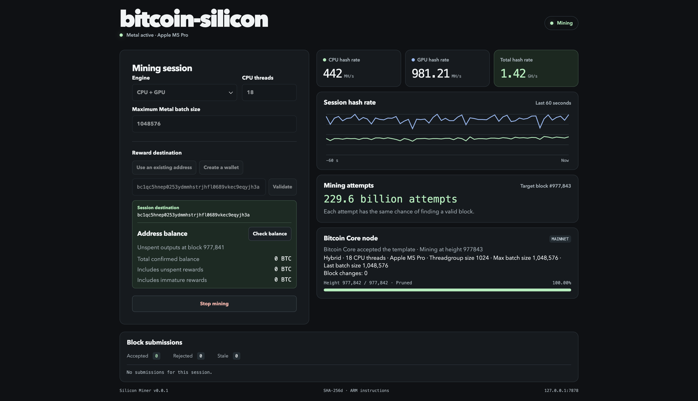
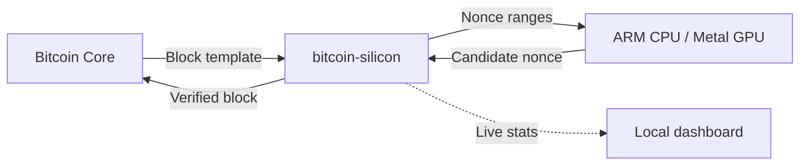

# bitcoin-silicon

**Solo Bitcoin mining on Apple Silicon.**

Give your Mac a shot at the next Bitcoin block. The miner gets work from your own Bitcoin Core node and searches for a valid hash using ARM SHA-256 instructions, the Metal GPU, or both. The local dashboard lets you watch the hash rate, see how many attempts you've made, and follow block submissions.

[Quick start](#quick-start) · [Documentation](DOCS.md) · [Benchmarks](#mining-benchmarks) · [MIT License](LICENSE)

[](docs/images/dashboard-mainnet.png)

*Hybrid mainnet session on an Apple M5 Pro. The CPU and Metal GPU deliver 1.42 GH/s combined at the time of capture.*

## Quick start

You'll need an **Apple Silicon Mac with macOS 13+**, a native arm64 terminal, the Apple command line tools (`xcode-select --install`), and [rustup](https://rustup.rs/). Allow roughly **30–50 GB** of free disk space for the pruned node and local files. [Installation details](DOCS.md#installation)

```sh
git clone https://github.com/loremipsum84/bitcoin-silicon.git
cd bitcoin-silicon
make setup
target/release/bitcoin-silicon start
```

Open the [local dashboard](http://127.0.0.1:7878/). Choose an engine, then validate a receiving address or use **Create a wallet** to make one and save an encrypted backup. [Wallet and recovery](DOCS.md#wallet-and-recovery)

**The first mainnet sync can take several hours.** You can click **Start mining** while it runs. Hashing begins once Bitcoin Core is fully synced (100%) and has accepted a block template.

Want to see a block land while mainnet syncs? Run `target/release/bitcoin-silicon demo cpu` to mine one on Bitcoin Core's local regtest chain. When you're done with mainnet, `target/release/bitcoin-silicon stop` shuts down the dashboard and mainnet node. [CLI mining and Stratum V1](DOCS.md#cli-mining) · [Local services](DOCS.md#services-and-local-data)

## How it works



Bitcoin Core supplies the block template. The miner builds the coinbase transaction for your receiving address, hands out nonce ranges to the selected engines, and checks candidate hashes on the CPU before submitting a full block to your node. [Engine internals and protocol references](DOCS.md#work-distribution-and-verification)

## Mining benchmarks

On this M5 Pro, adding four CPU workers gave the highest hash rate, and GPU-only did the most work per joule. These are median measurements with 1,048,576 nonces per Metal batch.

| Engine | Useful GH/s | SoC power |
| --- | ---: | ---: |
| Metal GPU | 1.1600 | 47.30 W |
| Metal + 4 CPU workers (`inherit`) | 1.2761 | 68.11 W |
| Metal + 4 CPU workers (`utility`) | 1.2175 | 52.26 W |

[Full results, methodology, and commands to reproduce the benchmarks](DOCS.md#mining-benchmarks)

## Contributing

Issues, ideas, and PRs are welcome. `make build` builds the miner and the AppKit wallet assistant. `cargo test --locked` runs the Rust tests. [Test matrix](DOCS.md#tests) · [Troubleshooting](DOCS.md#troubleshooting)
